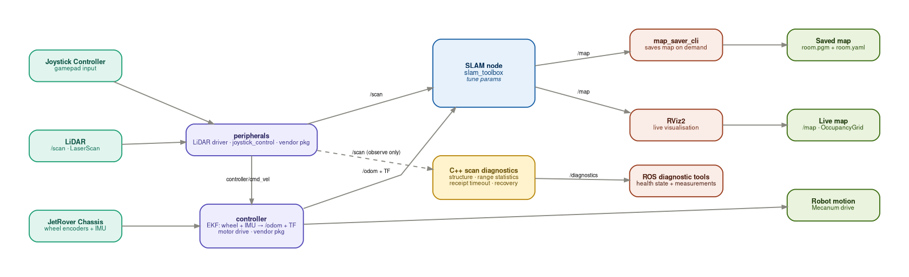
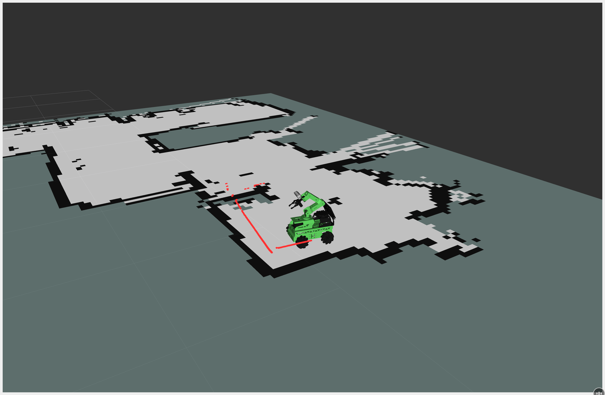
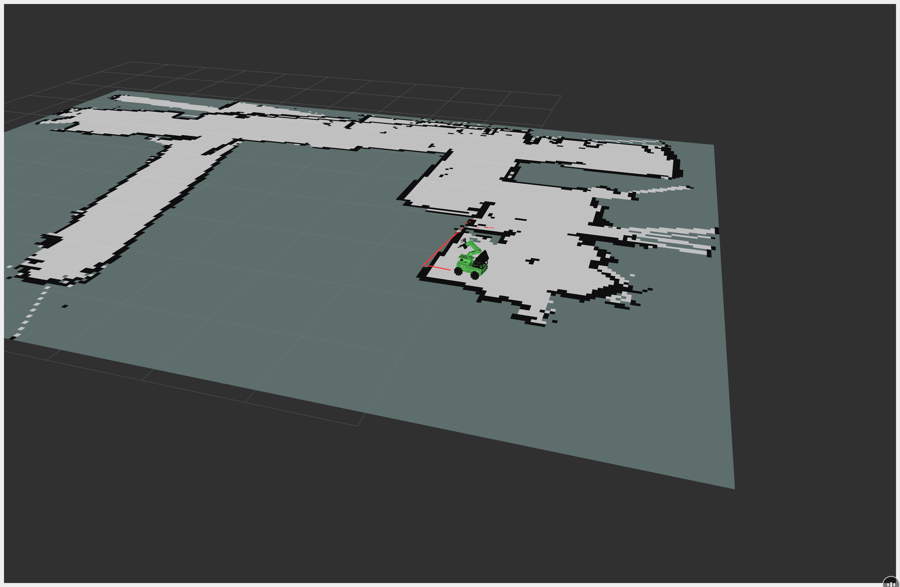
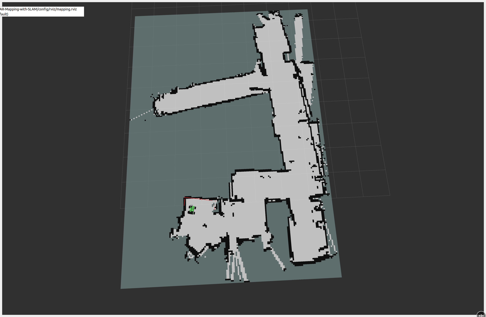
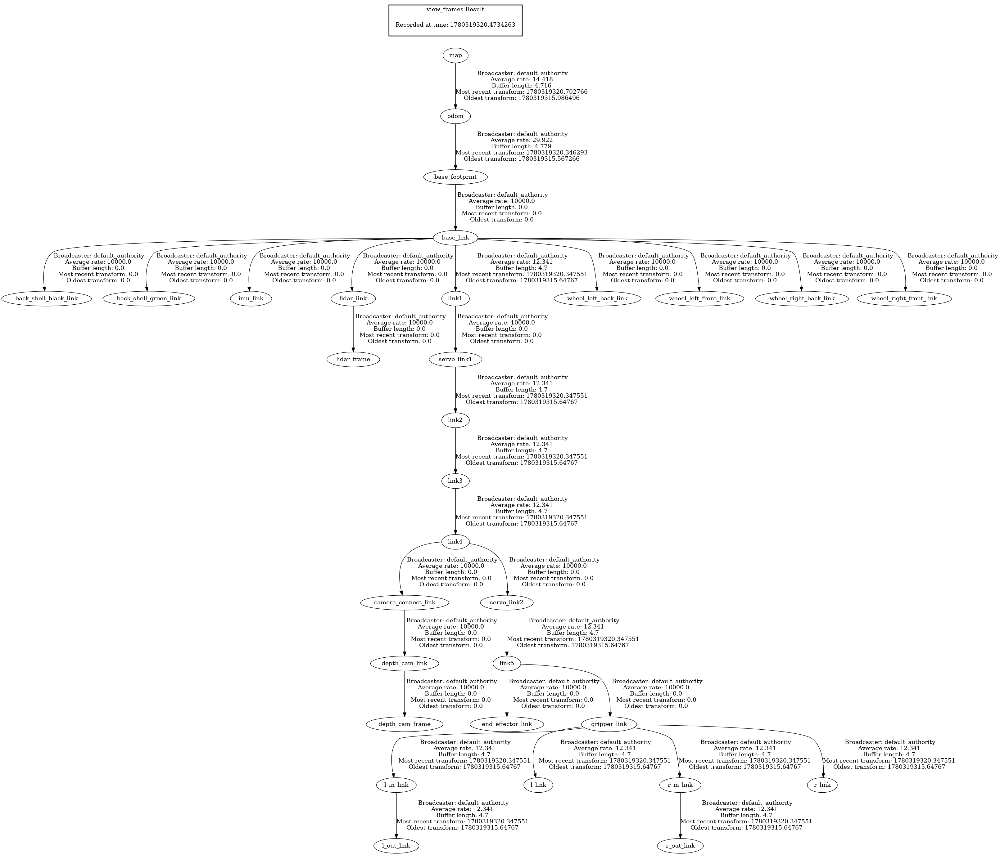

# 2D-LiDAR-Mapping-with-SLAM

ROS 2 Humble mapping integration for a JetRover, with C++17 LiDAR diagnostics, XML launch files, and live RViz2 visualization.

---

## Project Overview

Drive the HiWonder JetRover around a room while `slam_toolbox` builds a 2-D occupancy-grid map from LiDAR scans and wheel odometry. Save the map to disk when done.

This is the first project in a progressive JetRover series. The package combines a real-hardware mapping pipeline with a C++ scan-health monitor and a hardware-free diagnostic demo. SLAM is provided by the existing `slam_toolbox` package; this repository does not implement a new SLAM algorithm.

The repository-owned implementation uses C++17 and `ament_cmake`. Launch orchestration is XML. ROS tooling and the included HiWonder vendor launch files still depend on Python.

For implementation details, a demonstration script, and interview preparation, see [the C++ portfolio guide](docs/cpp_portfolio.md).

---

## Problem Statement

The robot enters an unknown room with no prior map. Using its LiDAR and wheel odometry, it must build a 2-D map in real time that can be saved and reused for future navigation.

---

## Hardware

| Component | Details |
|-----------|---------|
| Robot | HiWonder JetRover (Orin Nano version), Mecanum chassis |
| Compute | NVIDIA Jetson Orin Nano |
| LiDAR | SLAMTEC RPLidar A1 |

---

## Software

| Machine | Ubuntu | ROS 2 |
|---------|--------|-------|
| Jetson Orin Nano | 22.04 LTS | Humble |
| Host (dev machine) | 22.04 LTS | Humble |

The robot stack runs entirely on the Jetson. The host connects over DDS for visualization (RViz2) only.

---

## Architecture



See [`docs/architecture.md`](docs/architecture.md) for a full description of the pipeline.

---

## Directory Structure

```
2D-LiDAR-Mapping-with-SLAM/
├── config/
│   ├── slam_toolbox_params.yaml
│   └── rviz/
│       └── mapping.rviz
├── CMakeLists.txt              # ament_cmake build, installation, and tests
├── include/two_d_lidar_mapping_with_slam/
│   ├── scan_analysis.hpp       # scan validation and statistics
│   └── scan_diagnostics_node.hpp
├── src/                       # C++17 diagnostics and synthetic scan publisher
├── test/                      # C++ unit and ROS integration tests
├── launch/
│   ├── mapping.launch.xml     # vendor hardware + SLAM + diagnostics
│   ├── scan_diagnostics.launch.xml
│   └── diagnostics_demo.launch.xml
├── maps/                        # saved maps (.pgm, .yaml, .posegraph)
└── docs/
    ├── ROADMAP.md               # goals, success criteria, and milestones
    ├── architecture.md
    └── images/
```

---

## Dependencies

**On the Jetson (Humble):**

Dependencies are declared in `package.xml`. C++ development requires `rclcpp`, `rcl_interfaces`, `sensor_msgs`, and `diagnostic_msgs`; tests use `ament_cmake_gtest`. The mapping runtime requires `slam_toolbox` and `nav2_map_server`. HiWonder packages (`controller`, `peripherals`) are pre-installed on the Jetson and are not available from the public ROS package index.

**On the host (Humble):**
```zsh
sudo apt install ros-humble-rviz2              # for viewing the map
sudo apt install ros-humble-tf2-tools          # optional, for host-side TF debugging
```

---

## Development Workflow

Develop and test the C++ diagnostics on any Ubuntu 22.04 / ROS 2 Humble machine, or in the matching container. Deploy and validate the full mapping stack on the Jetson. The synthetic demo requires no vendor packages, robot, or display.

**Access the robot:**
```zsh
ssh ubuntu@192.168.2.138
```

For visualization, run RViz2 natively on your host machine — it connects to the Jetson over DDS.

> Note: `192.168.2.138` is a DHCP-assigned IP — update this if it changes.

---

## Getting Started

```zsh
# SSH into the Jetson
ssh ubuntu@192.168.2.138

# Stop the auto-start service
sudo systemctl stop start_app_node.service

# Clone the package into the workspace (if not already present)
cd ~/jetson_ws/src
git clone https://github.com/mahersabbagh80/2D-LiDAR-Mapping-with-SLAM.git

# Install dependencies
cd ~/jetson_ws
rosdep update
rosdep install --from-paths src --ignore-src -y --skip-keys="controller peripherals"

# Build
colcon build --symlink-install --packages-select two_d_lidar_mapping_with_slam --cmake-args -DCMAKE_BUILD_TYPE=RelWithDebInfo
source install/setup.zsh

# Launch the full mapping stack (controller + arm init + LiDAR + joystick + SLAM)
ros2 launch two_d_lidar_mapping_with_slam mapping.launch.xml
```

Drive the robot with the gamepad. On the host, open RViz2 with the pre-configured layout:

```zsh
rviz2 -d "$(ros2 pkg prefix --share two_d_lidar_mapping_with_slam)/config/rviz/mapping.rviz"
# or load it via File → Open Config inside RViz2
```

When done, save the map (run on the Jetson while the stack is still up):

```zsh
# Standard map files (.pgm + .yaml) for nav2
ros2 run nav2_map_server map_saver_cli -f /2D-LiDAR-Mapping-with-SLAM/maps/

# Pose graph (.data + .posegraph) — lets you resume mapping in a future session
ros2 service call /slam_toolbox/serialize_map slam_toolbox/srv/SerializePoseGraph \
  "{filename: '/home/ubuntu/jetson_ws/src/2D-LiDAR-Mapping-with-SLAM/maps/apartment'}"
```

---

## C++ development and hardware-free demo

In a clean ROS 2 Humble workspace containing this repository under `src/`:

```bash
source /opt/ros/humble/setup.bash
colcon build --packages-select two_d_lidar_mapping_with_slam \
  --cmake-args -DCMAKE_BUILD_TYPE=RelWithDebInfo -DBUILD_TESTING=ON
source install/setup.bash
colcon test --packages-select two_d_lidar_mapping_with_slam --return-code-on-test-failure
colcon test-result --verbose

# Terminal 1: cycles through healthy → degraded → malformed → missing → recovered
ros2 launch two_d_lidar_mapping_with_slam diagnostics_demo.launch.xml
# Terminal 2, after sourcing the same workspace:
ros2 topic echo /demo/diagnostics
```

The demo uses `/demo/scan` and `/demo/diagnostics`, keeping synthetic data separate from the real `/scan` stream. Each phase lasts five seconds; the sequence repeats every 25 seconds. Stop it with Ctrl+C. This demonstrates diagnostics, not SLAM or simulated robot motion.

Monitor a real or recorded scan stream independently:

```bash
ros2 launch two_d_lidar_mapping_with_slam scan_diagnostics.launch.xml scan_topic:=/scan
ros2 topic echo /diagnostics
```

The C++ node uses sensor-data QoS and reports `OK`, `WARN`, `ERROR`, or `STALE`. It never changes scan messages, TF, odometry, or motor commands. Configuration lives in `config/scan_diagnostics.yaml`; parameters are read-only after startup. A low finite-return fraction is a heuristic warning: open space can legitimately produce many infinite/no-return measurements. The monitor checks receipt freshness, not sensor timestamp correctness or TF availability.

**Migrating an existing Python build:** use fresh build/install directories to avoid loading stale Python launch artifacts. See [migration instructions](docs/cpp_portfolio.md#migrating-the-existing-workspace). The old implementation remains in Git history.

## Validation scope

The original apartment mapping results below were produced by the earlier hardware integration. The C++ migration is validated separately using Humble builds, C++ tests, and synthetic diagnostic messages; see [validation evidence](docs/validation.md). The updated full mapping launch must still be checked on the Jetson with its vendor packages and real sensors.

---

## Limitations

- 2-D only — no vertical structure
- Wheel odometry drifts on smooth floors, which may result in some inaccurate mappings
- Requires manual teleoperation (no autonomous exploration)

---

## Results

The robot successfully mapped a full apartment in a single session. Rooms, corridors, doorways, and furniture outlines are clearly resolved at 5 cm/cell resolution.

| Robot model with live LiDAR scan | Side view of the apartment |
|---|---|
|  |  |


*Completed apartment map — full floor layout resolved in a single teleoperated session*

### TF Tree

The live TF tree captured during a mapping session with the command: ′ros2 run tf2_tools view_frames′
Matches the expected `map → odom → base_footprint → base_link → lidar_link` chain described in the architecture.



---

## References

- [ROS 2 Humble Docs](https://docs.ros.org/en/humble/)
- [HiWonder JetRover Docs](https://docs.hiwonder.com/projects/JetRover/en/jetson-orin-nano/)
- [HiWonder Course for Mapping & Navigation](https://docs.hiwonder.com/projects/JetRover/en/jetson-orin-nano/docs/4.Mapping_Navigation_Course.html#mapping)
- [Goals & Roadmap](docs/ROADMAP.md)

**Packages used in this project:**

| Package | Type | Role | Docs / Source |
|---------|------|------|---------------|
| `slam_toolbox` | Community | SLAM — builds the map, publishes `map → odom` TF | [GitHub](https://github.com/SteveMacenski/slam_toolbox) |
| `robot_localization` (ekf_filter_node) | Community | Fuses wheel odometry, publishes `odom → base_footprint` TF | [GitHub](https://github.com/cra-ros-pkg/robot_localization) · [Docs](https://docs.ros.org/en/humble/p/robot_localization/) |
| `laser_filters` (scan_to_scan_filter_chain) | Official ROS | Filters raw LiDAR scan before SLAM | [GitHub](https://github.com/ros-perception/laser_filters) · [Docs](https://docs.ros.org/en/humble/p/laser_filters/) |
| `sllidar_ros2` (sllidar_node) | Hardware vendor (SLAMTEC, open source) | RPLidar A1 hardware driver | [GitHub](https://github.com/Slamtec/sllidar_ros2) |
| `ros_robot_controller` | Vendor (HiWonder, **closed source**) | Serial protocol driver to motor board — hardware interface | Pre-installed on Jetson |
| `controller` | Vendor (HiWonder, **closed source**) | Wheel odometry, EKF, servo control, arm init pose | Pre-installed on Jetson |
| `peripherals` | Vendor (HiWonder, **closed source**) | LiDAR driver launch, joystick control node | Pre-installed on Jetson |
