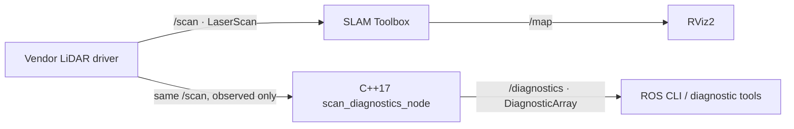

# Architecture


---

## Pipeline

### Mapping — sensor data to map

```
controller  ──/robot_description + TF: base_link→lidar_link──►  RViz2 (3D model)
controller  ──/odom + TF: odom→base_fp──►  slam_toolbox  ──/map──►  RViz2
                                                  ▲                   map_saver_cli
peripherals ──/scan───────────────────────────────┘
```

- `controller` (HiWonder) owns the full robot description stack: `robot_state_publisher` reads the URDF and publishes `/robot_description` (so RViz2 can render the 3D model) and static TF transforms between links (e.g. `base_link → lidar_link`). The servo controller reads hardware joint angles and publishes `/joint_states`, which `robot_state_publisher` uses to broadcast the arm transforms.
- `controller` also runs the full odometry stack: reads wheel encoders, filters the IMU, and fuses both through its built-in EKF. It publishes `/odom` and the `odom → base_footprint` transform.
- `peripherals` (HiWonder, wraps `sllidar_ros2`) reads the RPLidar A1 and publishes `/scan`.
- `slam_toolbox` consumes `/scan` and the TF tree to build the occupancy-grid map and publish it on `/map`.
- RViz2 displays the live map and the 3D robot model; `map_saver_cli` saves the map to disk at the end of a session.

### C++ scan-health monitoring



`scan_diagnostics_node` subscribes using `rclcpp::SensorDataQoS`, which accepts best-effort sensor publishers. Its scan-analysis library checks range/angle metadata, frame presence, array consistency, and finite in-range measurements. Positive infinity is counted as a no-return measurement; NaN, negative infinity, and finite out-of-range samples are counted separately as invalid.

A wall timer publishes diagnostics, even before the first scan arrives. Receipt freshness uses `std::chrono::steady_clock`, so paused simulation time and ROS clock jumps do not suppress a timeout. The node keeps only the most recent analysis and uses the default mutually exclusive callback group. Its callback state is serialized even if a multithreaded executor is used. Range analysis takes O(n) time and O(1) additional storage.

The monitor is a parallel observer: the existing `/scan → slam_toolbox` path, frame IDs, SLAM parameters, and motor-control topics are unchanged. An `expected_frame` parameter optionally checks an exact frame name. It does not validate TF availability, estimate localization accuracy, filter scans, or provide a motor safety interlock.

`mapping.launch.xml` preserves the original hardware launch action order and enables diagnostics by default. It still includes the vendor-owned Python launch files. The `start_robot` and `start_slam` arguments default to `true`; disabling both lets a cloud developer exercise the XML launch and diagnostics without hardware dependencies. `enable_diagnostics:=false` disables the new observer. Launch actions starting in order do not guarantee that hardware nodes are ready in that order; vendor readiness behavior is unchanged.

`diagnostics_demo.launch.xml` starts the C++ synthetic publisher and the same diagnostics executable on `/demo/scan` and `/demo/diagnostics`. It exercises sensor-health states without publishing robot commands or changing the real scan topic. See [the portfolio guide](cpp_portfolio.md) for the executable boundaries and interview explanation.

### Teleoperation — gamepad to wheels

```
peripherals (joystick_control)  ──controller/cmd_vel──►  controller  ──►  Mecanum wheels
```

- `peripherals` provides the `joystick_control` node, which reads gamepad input from `ros_robot_controller` and publishes velocity commands on `controller/cmd_vel`.
- `controller` receives `controller/cmd_vel` and drives the four Mecanum wheels accordingly.

---

## Why each package is in the pipeline

| Package | Role | Why this package |
|---------|------|-----------------|
| `controller` | Motor driver + odometry + robot description | HiWonder vendor package; ships with a pre-tuned EKF that fuses wheel encoders and the on-board IMU, runs `robot_state_publisher` with the URDF, and manages the servo controller for the arm |
| `peripherals` | LiDAR driver + joystick control | HiWonder vendor package; pre-configured for the RPLidar A1 and provides the joystick_control node for gamepad-driven teleoperation |
| `slam_toolbox` | SLAM — builds the map | Industry-standard ROS 2 SLAM library; async mode is safe for embedded hardware; supports map saving and later map reuse via pose graph serialization |

---

## Topics

| Topic | Message Type | Publisher | Subscriber(s) |
|-------|-------------|-----------|---------------|
| `/robot_description` | `std_msgs/String` | `controller` (robot_state_publisher) | RViz2 (3D model) |
| `/joint_states` | `sensor_msgs/JointState` | `controller` (servo_controller) | `robot_state_publisher` |
| `/scan` | `sensor_msgs/LaserScan` | `peripherals` (sllidar_ros2) | `slam_toolbox` |
| `/odom` | `nav_msgs/Odometry` | `controller` (vendor EKF) | `slam_toolbox` |
| `controller/cmd_vel` | `geometry_msgs/Twist` | `peripherals` (joystick_control) | `controller` |
| `/map` | `nav_msgs/OccupancyGrid` | `slam_toolbox` | RViz2, `map_saver_cli` |
| `/tf` | `tf2_msgs/TFMessage` | `controller`, `slam_toolbox` | all nodes |
| `/diagnostics` | `diagnostic_msgs/DiagnosticArray` | `scan_diagnostics_node` | ROS CLI / diagnostic tools |

- `/robot_description` — the full URDF as a string, published once with Transient Local QoS so late-joining subscribers (like RViz2 on the dev machine) still receive it.
- `/joint_states` — arm and gripper joint angles read from the hardware servos at ~12 Hz; fed into `robot_state_publisher` so the arm renders correctly in RViz2.
- `/scan` — raw distance readings from the LiDAR, one array of ranges per full rotation.
- `/odom` — wheel + IMU fused odometry from the vendor EKF; what `slam_toolbox` uses to track robot motion between scans.
- `controller/cmd_vel` — velocity command: linear x/y and angular z for Mecanum drive.
- `/map` — 2D occupancy grid where each cell is free (0), occupied (100), or unknown (-1).
- `/tf` — the transform tree; every node reads this to know where things are in space.

---

## TF Tree

The TF tree tracks the position of every physical part of the robot relative to each other and to the map. Every frame is a named coordinate origin attached to something real.

```
map
 └── odom                            (slam_toolbox — corrects drift, ~14 Hz)
      └── base_footprint             (ekf_filter_node — wheel + IMU fusion, ~30 Hz)
           └── base_link             (robot_state_publisher — rigid offset from footprint, static)
                └── lidar_link
                     └── lidar_frame (static — LiDAR mount position from URDF)
```

- `map` — fixed reference frame for the whole room. Published by `slam_toolbox`.
- `odom` — the robot's starting position. The `map → odom` transform is updated continuously by `slam_toolbox` to correct accumulated odometry drift.
- `base_footprint` — the 2D floor-projected center of the robot, updated at ~30 Hz by `ekf_filter_node` fusing wheel encoder odometry and IMU data.
- `base_link` — the 3D center of the robot body; a static transform above `base_footprint` defined in the URDF.
- `lidar_frame` — the LiDAR sensor origin; a static transform relative to `base_link` defined in the URDF. This is the frame that SLAM uses to place each scan correctly in the map.

When `slam_toolbox` receives a laser scan, it looks up the TF tree to find where `lidar_frame` was in the room at that exact timestamp — that is how it places each scan correctly in the map.
